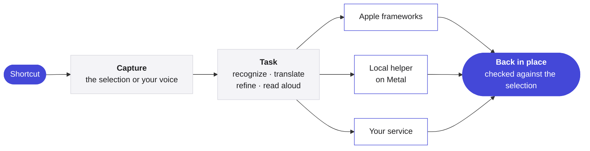

<p align="center">
  <picture>
    <source media="(prefers-color-scheme: dark)" srcset="Assets/Yullo-dark.png">
    
  </picture>
</p>

<h1 align="center">Yullo</h1>

<p align="center">
  <b>Your ideas, less effort.</b><br>
  Speak, translate, refine and listen, in any app on your Mac.
</p>

<p align="center">
  <a href="https://github.com/supnorm/Yullo/releases/latest"></a>
  
  
  
  <a href="LICENSE"></a>
  
</p>

<p align="center">
  <a href="https://yullo.me"><b>yullo.me</b></a>
  &nbsp;·&nbsp;
  <a href="https://github.com/supnorm/Yullo/releases/latest">Download</a>
  &nbsp;·&nbsp;
  <a href="#build-from-source">Build from source</a>
</p>

<p align="center">
  <sub>
    <b>English</b> ·
    <a href="docs/README.zh-Hans.md">简体中文</a> ·
    <a href="docs/README.zh-Hant.md">繁體中文</a> ·
    <a href="docs/README.fr.md">Français</a> ·
    <a href="docs/README.de.md">Deutsch</a> ·
    <a href="docs/README.it.md">Italiano</a> ·
    <a href="docs/README.es.md">Español</a>
  </sub>
</p>

<br>

In any app, Yullo is one shortcut away. Select a sentence, and it comes back translated or refined, right in place. Speak, and your words arrive where you are typing, as you said them, in another language, or in the style you chose.

It is a native Mac app. Its recognition, translation and voice models can run entirely on your Mac, and it connects to the services you already use when you prefer.

<br>

## Highlights

- **Four tasks, everywhere.** Dictate, translate, refine and read aloud in any app, through the system's own text fields, with Undo where the app supports it.
- **Native to the bone.** Swift, SwiftUI and AppKit on macOS 26, with Liquid Glass and the system's own controls.
- **Local inference on Apple Silicon.** whisper.cpp, transcribe.cpp, llama.cpp and audio.cpp, pinned and built from source, run on Metal with shaders compiled at build time, so a model is ready in a fraction of a second.
- **Live words as you speak.** Streaming recognition shows provisional text in the indicator. Only the finished text is inserted, translated or refined.
- **Bring your own engine.** Apple frameworks, downloadable local models, Ollama, any OpenAI-compatible API, the Codex CLI or Claude Code, and cloud voices, chosen per task.
- **Edit with voice or text.** Select text, then say or type what to change. The edit shows first, and Replace puts it in place.
- **Made to fit you.** Formats that turn plain speech into an email, notes or a layout of your own, chosen per app, and a personal vocabulary for the words you live with.
- **Seven languages.** The whole interface in English, Simplified and Traditional Chinese, French, German, Italian and Spanish.

<br>

## Engines

| Task | On your Mac | Or connect |
|:--|:--|:--|
| **Dictation** | Apple speech recognition, or Qwen3 ASR, Parakeet, Whisper, SenseVoice, Cohere Transcribe, Nemotron | — |
| **Translation** | Apple Translation, or Hy-MT2, TranslateGemma, Qwen3, or Ollama | Any OpenAI-compatible API, or the Codex CLI and Claude Code you already use |
| **Writing** | Apple's on-device model, or Ollama | Any OpenAI-compatible API, or the Codex CLI and Claude Code you already use |
| **Read aloud** | macOS voices, or Kokoro, Qwen3 TTS, CosyVoice 3 | Azure Speech, Google Cloud Text-to-Speech, ElevenLabs or a custom speech API |

Models are not part of this repository. Yullo downloads them inside the app, straight from their publishers, verifies each file, and recommends one for your Mac.

<br>

## Private by design

- Speech recognition runs on your Mac. With **On this Mac only**, every task does.
- A request carries the text or audio of the task at hand, and nothing around it.
- API keys live in the macOS Keychain, never in settings or files.
- Update checks send only the app's version, and can be turned off in Settings.
- No analytics, and no account.

<br>

## How it works



Local engines run as separate, signed helper processes inside the app bundle and stay loaded while you work, so later requests skip the start-up. Provider-independent rules, such as prompts, long-text planning and history retention, are written in Foundation-only Swift, apart from the interface.

<br>

## Install

For macOS 26 or later on Apple Silicon. If you use a coding agent, let it install Yullo for you:

> Install Yullo on this Mac from https://yullo.me/install.sh

Or in Terminal:

```sh
curl -fsSL https://yullo.me/install.sh | sh
```

The script downloads the latest release, checks it against its published SHA-256 and places Yullo in Applications. [Read it](https://github.com/supnorm/yullo.me/blob/main/install.sh) first if you like.

Prefer a disk image? Download `Yullo.dmg` from the [latest release](https://github.com/supnorm/Yullo/releases/latest) and drag Yullo into Applications. The first time you open it, macOS asks you to confirm: System Settings › Privacy & Security › Open Anyway.

Then open Yullo, and the welcome guide takes you through languages, permissions and a first dictation.

<br>

## Build from source

You need Xcode 26 (selected with `xcode-select`), `git`, `cmake` and `python3`.

```sh
git clone https://github.com/supnorm/Yullo.git
cd Yullo

# First time only: create a local code-signing identity
# (or use your own certificate: --identity <40-character SHA-1>)
python3 scripts/setup-signing.py --create

# Build, sign and check build/Yullo.app
bash build.sh

# Install it
python3 scripts/install-update.py --destination /Applications/Yullo.app
```

The first build fetches the pinned sources of the bundled runtimes and checks them, so it needs a network connection and takes a while. Keep the folder in a short path, such as `~/Yullo`, since the speech runtime limits path length. A build never downloads models.

<details>
<summary><b>Inside the repository</b></summary>

<br>

```
App/            the Mac app, one folder per area: Voice, Translation, ReadAloud, Selection, Settings…
Core/           provider-independent rules in Foundation-only Swift
Runtime/        thin wrappers around the local recognition, translation and speech runtimes
Localizations/  the interface in seven languages
Assets/         icon, font and the sample voice
scripts/        build, signing, packaging and install
```

</details>

<br>

## Feedback

Questions, ideas or bugs are welcome, in [Issues](https://github.com/supnorm/Yullo/issues) or at [hi@yullo.me](mailto:hi@yullo.me).

<br>

## Thanks

Yullo stands on the work of [whisper.cpp](https://github.com/ggml-org/whisper.cpp), [llama.cpp](https://github.com/ggml-org/llama.cpp) and [ggml](https://github.com/ggml-org/ggml), [transcribe.cpp](https://github.com/handy-computer/transcribe.cpp), audio.cpp, [eSpeak NG](https://github.com/espeak-ng/espeak-ng) and [IBM Plex Mono](https://github.com/IBM/plex), and of the people who publish the models it runs.

<br>

---

<p align="center">
  <sub>
    Free and open source under the <a href="LICENSE">Apache License 2.0</a>, with details in <a href="NOTICE">NOTICE</a>.<br>
    Yullo™ and the Yullo logo are trademarks and are not covered by the license.<br>
    Bundled components keep their own licenses, listed in the app under About › Open-source licenses.<br>
    The local speech helper includes eSpeak NG under GPL-3.0-or-later, with its complete source beside each release.<br>
    Downloadable models are provided by their publishers under their own terms.
  </sub>
</p>
