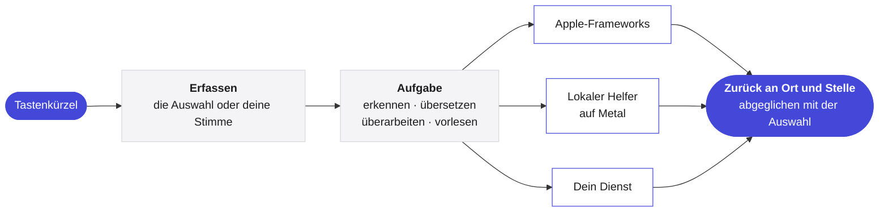

<p align="center">
  <picture>
    <source media="(prefers-color-scheme: dark)" srcset="../Assets/Yullo-dark.png">
    
  </picture>
</p>

<h1 align="center">Yullo</h1>

<p align="center">
  <b>Deine Ideen, weniger Aufwand.</b><br>
  Sprechen, übersetzen, überarbeiten und zuhören, in jeder App auf deinem Mac.
</p>

<p align="center">
  <a href="https://github.com/supnorm/Yullo/releases/latest"></a>
  
  
  
  <a href="../LICENSE"></a>
  
</p>

<p align="center">
  <a href="https://yullo.me"><b>yullo.me</b></a>
  &nbsp;·&nbsp;
  <a href="https://github.com/supnorm/Yullo/releases/latest">Download</a>
  &nbsp;·&nbsp;
  <a href="#build">Aus dem Quellcode bauen</a>
</p>

<p align="center">
  <sub>
    <a href="../README.md">English</a> ·
    <a href="README.zh-Hans.md">简体中文</a> ·
    <a href="README.zh-Hant.md">繁體中文</a> ·
    <a href="README.fr.md">Français</a> ·
    <b>Deutsch</b> ·
    <a href="README.it.md">Italiano</a> ·
    <a href="README.es.md">Español</a>
  </sub>
</p>

<br>

In jeder App ist Yullo nur ein Tastenkürzel entfernt. Markiere einen Satz, und er kommt übersetzt oder überarbeitet zurück, genau an seinen Platz. Sprich, und deine Worte landen dort, wo du schreibst, so wie du sie gesagt hast, in einer anderen Sprache oder im Stil deiner Wahl.

Yullo ist eine native Mac-App. Ihre Modelle für Erkennung, Übersetzung und Stimme können ganz auf deinem Mac laufen, und wenn du willst, verbindet sie sich mit den Diensten, die du schon nutzt.

<br>

## Auf einen Blick

- **Vier Aufgaben, überall.** Diktieren, übersetzen, überarbeiten und vorlesen in jeder App, über die Textfelder des Systems, mit Widerrufen, wo die App es unterstützt.
- **Durch und durch nativ.** Swift, SwiftUI und AppKit auf macOS 26, mit Liquid Glass und den Bedienelementen des Systems.
- **Lokale Inferenz auf Apple Silicon.** whisper.cpp, transcribe.cpp, llama.cpp und audio.cpp, fest versioniert und aus dem Quellcode gebaut, laufen auf Metal mit beim Build kompilierten Shadern, sodass ein Modell in Sekundenbruchteilen bereit ist.
- **Worte schon beim Sprechen.** Die Streaming-Erkennung zeigt vorläufigen Text in der Anzeige. Nur der fertige Text wird eingefügt, übersetzt oder überarbeitet.
- **Deine Engine, deine Wahl.** Apple-Frameworks, ladbare lokale Modelle, Ollama, jede OpenAI-kompatible API, die Codex CLI oder Claude Code und Online-Stimmen, für jede Aufgabe einzeln gewählt.
- **Per Sprache oder Text bearbeiten.** Text auswählen, dann sagen oder tippen, was sich ändern soll. Die Änderung erscheint zuerst, und Ersetzen setzt sie an ihre Stelle.
- **Ganz nach dir.** Formate, die aus schlicht Gesagtem eine E-Mail, Notizen oder ein eigenes Layout machen, für jede App einzeln gewählt, und ein persönliches Vokabular für die Wörter deines Alltags.
- **Sieben Sprachen.** Die ganze Oberfläche auf Englisch, vereinfachtem und traditionellem Chinesisch, Französisch, Deutsch, Italienisch und Spanisch.

<br>

## Engines

| Aufgabe | Auf deinem Mac | Oder online |
|:--|:--|:--|
| **Diktat** | Spracherkennung von Apple, oder Qwen3 ASR, Parakeet, Whisper, SenseVoice, Cohere Transcribe, Nemotron | — |
| **Übersetzung** | Apple-Übersetzung, oder Hy-MT2, TranslateGemma, Qwen3, oder Ollama | Jede OpenAI-kompatible API, oder die Codex CLI und Claude Code, die du schon nutzt |
| **Schreiben** | Apples Modell auf dem Gerät, oder Ollama | Jede OpenAI-kompatible API, oder die Codex CLI und Claude Code, die du schon nutzt |
| **Vorlesen** | macOS-Stimmen, oder Kokoro, Qwen3 TTS, CosyVoice 3 | Azure Speech, Google Cloud Text-to-Speech, ElevenLabs oder eine eigene Sprach-API |

Modelle sind nicht Teil dieses Repositorys. Yullo lädt sie in der App direkt bei ihren Herausgebern, prüft jede Datei und empfiehlt eines für deinen Mac.

<br>

## Privat von Grund auf

- Die Spracherkennung läuft auf deinem Mac. Mit <b>Nur auf diesem Mac</b> jede Aufgabe.
- Eine Anfrage enthält nur den Text oder das Audio der aktuellen Aufgabe, nichts drumherum.
- API-Schlüssel liegen im macOS-Schlüsselbund, nie in Einstellungen oder Dateien.
- Die Suche nach Updates sendet nur die Version der App und lässt sich in den Einstellungen ausschalten.
- Keine Analysen, kein Konto.

<br>

## So funktioniert es



Lokale Engines laufen als eigene, signierte Hilfsprozesse im App-Paket und bleiben geladen, während du arbeitest, sodass spätere Anfragen den Start überspringen. Anbieterunabhängige Regeln wie Prompts, die Planung langer Texte und die Aufbewahrung des Verlaufs sind in Swift geschrieben, das nur Foundation braucht, getrennt von der Oberfläche.

<br>

## Installieren

Für macOS 26 oder neuer auf Apple Silicon. Wenn du einen Coding-Agenten nutzt, lass ihn Yullo für dich installieren:

> Installiere Yullo auf diesem Mac mit https://yullo.me/install.sh

Oder im Terminal:

```sh
curl -fsSL https://yullo.me/install.sh | sh
```

Das Skript lädt die neueste Version, prüft sie gegen ihre veröffentlichte SHA-256 und legt Yullo in „Programme“. [Lies es](https://github.com/supnorm/yullo.me/blob/main/install.sh) vorher, wenn du magst.

Lieber ein Disk-Image? Lade `Yullo.dmg` aus der [neuesten Version](https://github.com/supnorm/Yullo/releases/latest) und zieh Yullo in „Programme“. Beim ersten Öffnen bittet dich macOS um Bestätigung: Systemeinstellungen › Datenschutz & Sicherheit › Dennoch öffnen.

Öffne dann Yullo, und der Willkommensassistent führt dich durch Sprachen, Berechtigungen und ein erstes Diktat.

<br>

<a id="build"></a>

## Aus dem Quellcode bauen

Du brauchst Xcode 26 (mit `xcode-select` ausgewählt), `git`, `cmake` und `python3`.

```sh
git clone https://github.com/supnorm/Yullo.git
cd Yullo

# Nur beim ersten Mal: eine lokale Signaturidentität erstellen
# (oder dein eigenes Zertifikat nutzen: --identity <40-stelliger SHA-1>)
python3 scripts/setup-signing.py --create

# build/Yullo.app bauen, signieren und prüfen
bash build.sh

# Installieren
python3 scripts/install-update.py --destination /Applications/Yullo.app
```

Der erste Build holt und prüft die fest versionierten Quellen der enthaltenen Laufzeiten, braucht also eine Verbindung und etwas Zeit. Leg den Ordner in einen kurzen Pfad, etwa `~/Yullo`, denn die Sprachlaufzeit begrenzt die Pfadlänge. Ein Build lädt nie Modelle.

<details>
<summary><b>Das Repository im Überblick</b></summary>

<br>

```
App/            die Mac-App, ein Ordner pro Bereich: Voice, Translation, ReadAloud, Selection, Settings…
Core/           anbieterunabhängige Regeln, in Swift nur mit Foundation
Runtime/        schlanke Hüllen um die lokalen Laufzeiten für Erkennung, Übersetzung und Stimme
Localizations/  die Oberfläche in sieben Sprachen
Assets/         Symbol, Schrift und die Beispielstimme
scripts/        Bauen, Signieren, Paketieren und Installieren
```

</details>

<br>

## Feedback

Fragen, Ideen oder Fehler sind willkommen, in den [Issues](https://github.com/supnorm/Yullo/issues) oder an [hi@yullo.me](mailto:hi@yullo.me).

<br>

## Danke

Yullo baut auf der Arbeit von [whisper.cpp](https://github.com/ggml-org/whisper.cpp), [llama.cpp](https://github.com/ggml-org/llama.cpp), [ggml](https://github.com/ggml-org/ggml), [transcribe.cpp](https://github.com/handy-computer/transcribe.cpp), audio.cpp, [eSpeak NG](https://github.com/espeak-ng/espeak-ng) und [IBM Plex Mono](https://github.com/IBM/plex) auf, und auf der der Menschen, die die Modelle veröffentlichen, die es ausführt.

<br>

---

<p align="center">
  <sub>
    Frei und quelloffen unter der <a href="../LICENSE">Apache-Lizenz 2.0</a>, Details in <a href="../NOTICE">NOTICE</a>.<br>
    Yullo™ und das Yullo-Logo sind Marken und fallen nicht unter die Lizenz.<br>
    Enthaltene Komponenten behalten ihre eigenen Lizenzen, aufgeführt in der App unter Über › Open-Source-Lizenzen.<br>
    Der lokale Sprachhelfer enthält eSpeak NG unter GPL-3.0-or-later, mit vollständigem Quellcode neben jeder Version.<br>
    Ladbare Modelle werden von ihren Herausgebern zu deren eigenen Bedingungen bereitgestellt.
  </sub>
</p>
