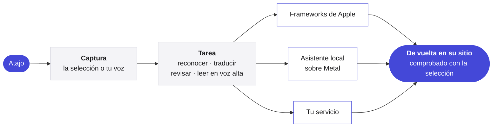

<p align="center">
  <picture>
    <source media="(prefers-color-scheme: dark)" srcset="../Assets/Yullo-dark.png">
    
  </picture>
</p>

<h1 align="center">Yullo</h1>

<p align="center">
  <b>Tus ideas, menos esfuerzo.</b><br>
  Habla, traduce, revisa y escucha, en cualquier app de tu Mac.
</p>

<p align="center">
  <a href="https://github.com/supnorm/Yullo/releases/latest"></a>
  
  
  
  <a href="../LICENSE"></a>
  
</p>

<p align="center">
  <a href="https://yullo.me"><b>yullo.me</b></a>
  &nbsp;·&nbsp;
  <a href="https://github.com/supnorm/Yullo/releases/latest">Descargar</a>
  &nbsp;·&nbsp;
  <a href="#build">Compilar desde el código</a>
</p>

<p align="center">
  <sub>
    <a href="../README.md">English</a> ·
    <a href="README.zh-Hans.md">简体中文</a> ·
    <a href="README.zh-Hant.md">繁體中文</a> ·
    <a href="README.fr.md">Français</a> ·
    <a href="README.de.md">Deutsch</a> ·
    <a href="README.it.md">Italiano</a> ·
    <b>Español</b>
  </sub>
</p>

<br>

En cualquier app, Yullo está a un atajo de distancia. Selecciona una frase, y vuelve traducida o revisada, justo en su sitio. Habla, y tus palabras llegan donde estás escribiendo, tal como las dijiste, en otro idioma o con el estilo que elegiste.

Es una app nativa para Mac. Sus modelos de reconocimiento, traducción y voz pueden funcionar por completo en tu Mac, y se conecta a los servicios que ya usas cuando lo prefieres.

<br>

## Lo esencial

- **Cuatro tareas, en todas partes.** Dicta, traduce, revisa y escucha en cualquier app, a través de los campos de texto del sistema, con Deshacer cuando la app lo permite.
- **Nativa hasta la médula.** Swift, SwiftUI y AppKit en macOS 26, con Liquid Glass y los controles del sistema.
- **Inferencia local en Apple Silicon.** whisper.cpp, transcribe.cpp, llama.cpp y audio.cpp, con versiones fijas y compilados desde el código, funcionan sobre Metal con shaders compilados al construir, así que un modelo está listo en una fracción de segundo.
- **Las palabras mientras hablas.** El reconocimiento en streaming muestra texto provisional en el indicador. Solo el texto final se inserta, se traduce o se revisa.
- **Elige tu motor.** Frameworks de Apple, modelos locales descargables, Ollama, cualquier API compatible con OpenAI, Codex CLI o Claude Code, y voces en línea, elegidos para cada tarea.
- **Editar con la voz o con texto.** Selecciona texto y luego di o escribe qué cambiar. La edición se muestra primero y Reemplazar la pone en su lugar.
- **Hecho a tu medida.** Formatos que convierten lo que dices con sencillez en un correo, notas o un formato propio, elegidos para cada app, y un vocabulario personal para las palabras de tu día a día.
- **Siete idiomas.** Toda la interfaz en inglés, chino simplificado y tradicional, francés, alemán, italiano y español.

<br>

## Motores

| Tarea | En tu Mac | O en línea |
|:--|:--|:--|
| **Dictado** | Reconocimiento de voz de Apple, o Qwen3 ASR, Parakeet, Whisper, SenseVoice, Cohere Transcribe, Nemotron | — |
| **Traducción** | Traducción de Apple, o Hy-MT2, TranslateGemma, Qwen3, u Ollama | Cualquier API compatible con OpenAI, o los Codex CLI y Claude Code que ya usas |
| **Escritura** | El modelo de Apple en el dispositivo, u Ollama | Cualquier API compatible con OpenAI, o los Codex CLI y Claude Code que ya usas |
| **Lectura en voz alta** | Voces de macOS, o Kokoro, Qwen3 TTS, CosyVoice 3 | Azure Speech, Google Cloud Text-to-Speech, ElevenLabs o una API de voz personalizada |

Los modelos no forman parte de este repositorio. Yullo los descarga dentro de la app, directamente de sus editores, verifica cada archivo y te recomienda uno para tu Mac.

<br>

## Privada por diseño

- El reconocimiento de voz funciona en tu Mac. Con <b>Solo en este Mac</b>, todas las tareas también.
- Una solicitud lleva solo el texto o el audio de la tarea en curso, y nada más.
- Las claves de API viven en el llavero de macOS, nunca en ajustes ni en archivos.
- La búsqueda de actualizaciones solo envía la versión de la app y se puede desactivar en Ajustes.
- Sin analíticas, y sin cuenta.

<br>

## Cómo funciona



Los motores locales funcionan como procesos auxiliares firmados e independientes dentro del paquete de la app, y siguen cargados mientras trabajas, así que las siguientes solicitudes se saltan el arranque. Las reglas independientes del proveedor, como los prompts, la planificación de textos largos y la conservación del historial, están escritas en Swift que solo depende de Foundation, aparte de la interfaz.

<br>

## Instalar

Para macOS 26 o posterior en Apple Silicon. Si usas un agente de programación, deja que instale Yullo por ti:

> Instala Yullo en este Mac con https://yullo.me/install.sh

O en Terminal:

```sh
curl -fsSL https://yullo.me/install.sh | sh
```

El script descarga la última versión, la comprueba con su SHA-256 publicado y coloca Yullo en Aplicaciones. [Léelo](https://github.com/supnorm/yullo.me/blob/main/install.sh) antes si quieres.

¿Prefieres una imagen de disco? Descarga `Yullo.dmg` de la [última versión](https://github.com/supnorm/Yullo/releases/latest) y arrastra Yullo a Aplicaciones. La primera vez que lo abras, macOS te pedirá que confirmes: Ajustes del Sistema › Privacidad y seguridad › Abrir igualmente.

Después abre Yullo, y la guía de bienvenida te acompaña con los idiomas, los permisos y un primer dictado.

<br>

<a id="build"></a>

## Compilar desde el código

Necesitas Xcode 26 (seleccionado con `xcode-select`), `git`, `cmake` y `python3`.

```sh
git clone https://github.com/supnorm/Yullo.git
cd Yullo

# Solo la primera vez: crear una identidad de firma local
# (o usar tu propio certificado: --identity <SHA-1 de 40 caracteres>)
python3 scripts/setup-signing.py --create

# Compilar, firmar y comprobar build/Yullo.app
bash build.sh

# Instalarlo
python3 scripts/install-update.py --destination /Applications/Yullo.app
```

La primera compilación descarga y comprueba las fuentes con versiones fijas de los motores incluidos, así que necesita conexión y tarda un rato. Guarda la carpeta en una ruta corta, como `~/Yullo`, porque el motor de voz limita la longitud de las rutas. Una compilación nunca descarga modelos.

<details>
<summary><b>El repositorio de un vistazo</b></summary>

<br>

```
App/            la app para Mac, una carpeta por área: Voice, Translation, ReadAloud, Selection, Settings…
Core/           reglas independientes del proveedor, en Swift solo con Foundation
Runtime/        envoltorios ligeros de los motores locales de reconocimiento, traducción y voz
Localizations/  la interfaz en siete idiomas
Assets/         icono, tipografía y voz de ejemplo
scripts/        compilación, firma, empaquetado e instalación
```

</details>

<br>

## Comentarios

Preguntas, ideas o errores son bienvenidos, en [Issues](https://github.com/supnorm/Yullo/issues) o en [hi@yullo.me](mailto:hi@yullo.me).

<br>

## Gracias

Yullo se apoya en el trabajo de [whisper.cpp](https://github.com/ggml-org/whisper.cpp), [llama.cpp](https://github.com/ggml-org/llama.cpp), [ggml](https://github.com/ggml-org/ggml), [transcribe.cpp](https://github.com/handy-computer/transcribe.cpp), audio.cpp, [eSpeak NG](https://github.com/espeak-ng/espeak-ng) y [IBM Plex Mono](https://github.com/IBM/plex), y en el de quienes publican los modelos que ejecuta.

<br>

---

<p align="center">
  <sub>
    Libre y de código abierto bajo la <a href="../LICENSE">licencia Apache 2.0</a>, con detalles en <a href="../NOTICE">NOTICE</a>.<br>
    Yullo™ y el logotipo de Yullo son marcas y no están cubiertos por la licencia.<br>
    Los componentes incluidos mantienen sus propias licencias, listadas en la app en Acerca de › Licencias de código abierto.<br>
    El asistente de voz local incluye eSpeak NG bajo GPL-3.0-or-later, con su código completo junto a cada versión.<br>
    Los modelos descargables los ofrecen sus editores según sus propios términos.
  </sub>
</p>
