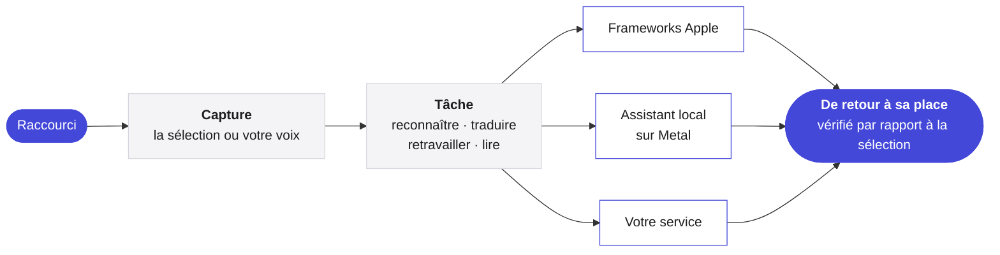

<p align="center">
  <picture>
    <source media="(prefers-color-scheme: dark)" srcset="../Assets/Yullo-dark.png">
    
  </picture>
</p>

<h1 align="center">Yullo</h1>

<p align="center">
  <b>Vos idées, plus simplement.</b><br>
  Parlez, traduisez, retravaillez et écoutez, dans n’importe quelle app de votre Mac.
</p>

<p align="center">
  <a href="https://github.com/supnorm/Yullo/releases/latest"></a>
  
  
  
  <a href="../LICENSE"></a>
  
</p>

<p align="center">
  <a href="https://yullo.me"><b>yullo.me</b></a>
  &nbsp;·&nbsp;
  <a href="https://github.com/supnorm/Yullo/releases/latest">Télécharger</a>
  &nbsp;·&nbsp;
  <a href="#build">Compiler depuis les sources</a>
</p>

<p align="center">
  <sub>
    <a href="../README.md">English</a> ·
    <a href="README.zh-Hans.md">简体中文</a> ·
    <a href="README.zh-Hant.md">繁體中文</a> ·
    <b>Français</b> ·
    <a href="README.de.md">Deutsch</a> ·
    <a href="README.it.md">Italiano</a> ·
    <a href="README.es.md">Español</a>
  </sub>
</p>

<br>

Dans n’importe quelle app, Yullo est à un raccourci. Sélectionnez une phrase, elle revient traduite ou retravaillée, à sa place. Parlez, et vos mots arrivent là où vous écrivez, tels que vous les avez dits, dans une autre langue, ou dans le style choisi.

C’est une app Mac native. Ses modèles de reconnaissance, de traduction et de voix peuvent tourner entièrement sur votre Mac, et elle se connecte aux services que vous utilisez déjà quand vous le préférez.

<br>

## En bref

- **Quatre tâches, partout.** Dictez, traduisez, retravaillez et écoutez dans n’importe quelle app, par les champs de texte du système, avec Annuler quand l’app le permet.
- **Natif jusqu’au bout.** Swift, SwiftUI et AppKit sur macOS 26, avec Liquid Glass et les commandes du système.
- **Inférence locale sur Apple Silicon.** whisper.cpp, transcribe.cpp, llama.cpp et audio.cpp, figés et compilés depuis les sources, tournent sur Metal avec des shaders compilés à la construction, si bien qu’un modèle est prêt en une fraction de seconde.
- **Les mots pendant que vous parlez.** La reconnaissance en continu affiche un texte provisoire dans l’indicateur. Seul le texte final est inséré, traduit ou retravaillé.
- **Choisissez votre moteur.** Frameworks Apple, modèles locaux téléchargeables, Ollama, toute API compatible OpenAI, Codex CLI ou Claude Code, et voix en ligne, au choix pour chaque tâche.
- **Modifier par la voix ou par écrit.** Sélectionnez du texte, puis dites ou tapez ce qu’il faut changer. La modification s’affiche d’abord, et Remplacer la met à sa place.
- **Fait pour vous.** Des formats qui font d’une phrase dite simplement un e-mail, des notes ou une mise en forme à vous, choisis app par app, et un vocabulaire personnel pour les mots de votre quotidien.
- **Sept langues.** Toute l’interface en anglais, chinois simplifié et traditionnel, français, allemand, italien et espagnol.

<br>

## Moteurs

| Tâche | Sur votre Mac | Ou en ligne |
|:--|:--|:--|
| **Dictée** | Reconnaissance vocale d’Apple, ou Qwen3 ASR, Parakeet, Whisper, SenseVoice, Cohere Transcribe, Nemotron | — |
| **Traduction** | Traduction d’Apple, ou Hy-MT2, TranslateGemma, Qwen3, ou Ollama | Toute API compatible OpenAI, ou les Codex CLI et Claude Code que vous utilisez déjà |
| **Rédaction** | Le modèle d’Apple sur l’appareil, ou Ollama | Toute API compatible OpenAI, ou les Codex CLI et Claude Code que vous utilisez déjà |
| **Lecture vocale** | Voix de macOS, ou Kokoro, Qwen3 TTS, CosyVoice 3 | Azure Speech, Google Cloud Text-to-Speech, ElevenLabs ou une API vocale personnalisée |

Les modèles ne font pas partie de ce dépôt. Yullo les télécharge dans l’app, directement auprès de leurs éditeurs, vérifie chaque fichier et en recommande un pour votre Mac.

<br>

## Confidentiel par conception

- La reconnaissance vocale tourne sur votre Mac. Avec <b>Uniquement sur ce Mac</b>, toutes les tâches aussi.
- Une requête ne contient que le texte ou l’audio de la tâche en cours, rien autour.
- Les clés d’API restent dans le trousseau de macOS, jamais dans les réglages ni dans des fichiers.
- La recherche de mises à jour n’envoie que la version de l’app et peut être désactivée dans les Réglages.
- Aucune analyse d’usage, aucun compte.

<br>

## Comment ça marche



Les moteurs locaux tournent comme processus d’assistance signés et séparés, dans le paquet de l’app, et restent chargés pendant que vous travaillez, si bien que les requêtes suivantes évitent le démarrage. Les règles indépendantes des fournisseurs, comme les invites, la planification des longs textes et la conservation de l’historique, sont écrites en Swift qui ne dépend que de Foundation, à l’écart de l’interface.

<br>

## Installer

Pour macOS 26 ou ultérieur sur Apple Silicon. Si vous utilisez un agent de code, laissez-le installer Yullo pour vous :

> Installe Yullo sur ce Mac avec https://yullo.me/install.sh

Ou dans le Terminal :

```sh
curl -fsSL https://yullo.me/install.sh | sh
```

Le script télécharge la dernière version, la vérifie avec son SHA-256 publié et place Yullo dans Applications. [Lisez-le](https://github.com/supnorm/yullo.me/blob/main/install.sh) d’abord si vous le souhaitez.

Vous préférez une image disque ? Téléchargez `Yullo.dmg` depuis la [dernière version](https://github.com/supnorm/Yullo/releases/latest) et glissez Yullo dans Applications. À la première ouverture, macOS vous demande de confirmer : Réglages Système › Confidentialité et sécurité › Ouvrir quand même.

Ouvrez ensuite Yullo, et le guide de bienvenue vous accompagne pour les langues, les autorisations et une première dictée.

<br>

<a id="build"></a>

## Compiler depuis les sources

Il vous faut Xcode 26 (sélectionné avec `xcode-select`), `git`, `cmake` et `python3`.

```sh
git clone https://github.com/supnorm/Yullo.git
cd Yullo

# Première fois seulement : créer une identité de signature locale
# (ou utiliser votre propre certificat : --identity <SHA-1 de 40 caractères>)
python3 scripts/setup-signing.py --create

# Compiler, signer et vérifier build/Yullo.app
bash build.sh

# L’installer
python3 scripts/install-update.py --destination /Applications/Yullo.app
```

La première compilation récupère et vérifie les sources figées des moteurs intégrés : elle demande une connexion et prend un moment. Gardez le dossier dans un chemin court, comme `~/Yullo`, car le moteur vocal limite la longueur des chemins. Une compilation ne télécharge jamais de modèles.

<details>
<summary><b>Le dépôt en un coup d’œil</b></summary>

<br>

```
App/            l’app Mac, un dossier par domaine : Voice, Translation, ReadAloud, Selection, Settings…
Core/           les règles indépendantes des fournisseurs, en Swift sur Foundation seul
Runtime/        de fines couches autour des moteurs locaux de reconnaissance, traduction et voix
Localizations/  l’interface en sept langues
Assets/         icône, police et voix d’exemple
scripts/        compilation, signature, empaquetage et installation
```

</details>

<br>

## Retours

Questions, idées ou bogues sont les bienvenus, dans les [Issues](https://github.com/supnorm/Yullo/issues) ou à [hi@yullo.me](mailto:hi@yullo.me).

<br>

## Merci

Yullo s’appuie sur le travail de [whisper.cpp](https://github.com/ggml-org/whisper.cpp), [llama.cpp](https://github.com/ggml-org/llama.cpp), [ggml](https://github.com/ggml-org/ggml), [transcribe.cpp](https://github.com/handy-computer/transcribe.cpp), audio.cpp, [eSpeak NG](https://github.com/espeak-ng/espeak-ng) et [IBM Plex Mono](https://github.com/IBM/plex), et sur celui des personnes qui publient les modèles qu’il fait tourner.

<br>

---

<p align="center">
  <sub>
    Libre et gratuit sous <a href="../LICENSE">licence Apache 2.0</a>, détails dans <a href="../NOTICE">NOTICE</a>.<br>
    Yullo™ et le logo Yullo sont des marques et ne sont pas couverts par la licence.<br>
    Les composants intégrés gardent leurs propres licences, listées dans l’app sous À propos › Licences open source.<br>
    L’assistant vocal local inclut eSpeak NG sous GPL-3.0-or-later, avec ses sources complètes à côté de chaque version.<br>
    Les modèles téléchargeables sont fournis par leurs éditeurs selon leurs propres conditions.
  </sub>
</p>
