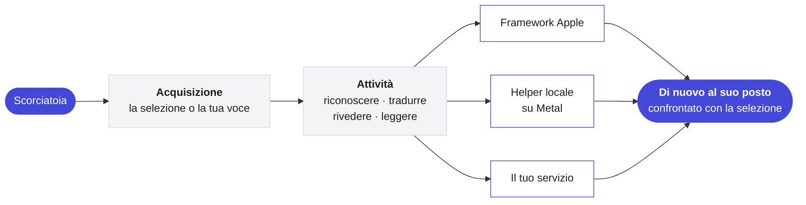

<p align="center">
  <picture>
    <source media="(prefers-color-scheme: dark)" srcset="../Assets/Yullo-dark.png">
    
  </picture>
</p>

<h1 align="center">Yullo</h1>

<p align="center">
  <b>Le tue idee, meno fatica.</b><br>
  Parla, traduci, rivedi e ascolta, in qualsiasi app del tuo Mac.
</p>

<p align="center">
  <a href="https://github.com/supnorm/Yullo/releases/latest"></a>
  
  
  
  <a href="../LICENSE"></a>
  
</p>

<p align="center">
  <a href="https://yullo.me"><b>yullo.me</b></a>
  &nbsp;·&nbsp;
  <a href="https://github.com/supnorm/Yullo/releases/latest">Scarica</a>
  &nbsp;·&nbsp;
  <a href="#build">Compila dal sorgente</a>
</p>

<p align="center">
  <sub>
    <a href="../README.md">English</a> ·
    <a href="README.zh-Hans.md">简体中文</a> ·
    <a href="README.zh-Hant.md">繁體中文</a> ·
    <a href="README.fr.md">Français</a> ·
    <a href="README.de.md">Deutsch</a> ·
    <b>Italiano</b> ·
    <a href="README.es.md">Español</a>
  </sub>
</p>

<br>

In qualsiasi app, Yullo è a una scorciatoia di distanza. Seleziona una frase, e torna tradotta o rivista, proprio al suo posto. Parla, e le tue parole arrivano dove stai scrivendo, così come le hai dette, in un’altra lingua o nello stile che hai scelto.

È un’app Mac nativa. I suoi modelli di riconoscimento, traduzione e voce possono funzionare interamente sul tuo Mac, e quando preferisci si collega ai servizi che usi già.

<br>

## In breve

- **Quattro attività, ovunque.** Detta, traduci, rivedi e ascolta in qualsiasi app, attraverso i campi di testo del sistema, con Annulla dove l’app lo consente.
- **Nativa fino in fondo.** Swift, SwiftUI e AppKit su macOS 26, con Liquid Glass e i controlli del sistema.
- **Inferenza locale su Apple Silicon.** whisper.cpp, transcribe.cpp, llama.cpp e audio.cpp, a versione fissa e compilati dal sorgente, girano su Metal con shader compilati in fase di build, così un modello è pronto in una frazione di secondo.
- **Le parole mentre parli.** Il riconoscimento in streaming mostra testo provvisorio nell’indicatore. Solo il testo finale viene inserito, tradotto o rivisto.
- **Scegli il tuo motore.** Framework Apple, modelli locali scaricabili, Ollama, qualsiasi API compatibile con OpenAI, Codex CLI o Claude Code e voci online, scelti per ogni attività.
- **Modifica con la voce o il testo.** Seleziona del testo, poi di’ o scrivi cosa cambiare. La modifica appare prima, e Sostituisci la mette al suo posto.
- **Su misura per te.** Formati che trasformano una frase detta semplicemente in un’email, in note o in un formato tuo, scelti app per app, e un vocabolario personale per le parole della tua vita.
- **Sette lingue.** Tutta l’interfaccia in inglese, cinese semplificato e tradizionale, francese, tedesco, italiano e spagnolo.

<br>

## Motori

| Attività | Sul tuo Mac | Oppure online |
|:--|:--|:--|
| **Dettatura** | Riconoscimento vocale di Apple, oppure Qwen3 ASR, Parakeet, Whisper, SenseVoice, Cohere Transcribe, Nemotron | — |
| **Traduzione** | Traduzione di Apple, oppure Hy-MT2, TranslateGemma, Qwen3, oppure Ollama | Qualsiasi API compatibile con OpenAI, oppure Codex CLI e Claude Code che usi già |
| **Scrittura** | Il modello di Apple sul dispositivo, oppure Ollama | Qualsiasi API compatibile con OpenAI, oppure Codex CLI e Claude Code che usi già |
| **Lettura** | Voci di macOS, oppure Kokoro, Qwen3 TTS, CosyVoice 3 | Azure Speech, Google Cloud Text-to-Speech, ElevenLabs o un’API vocale personalizzata |

I modelli non fanno parte di questo repository. Yullo li scarica nell’app, direttamente dai loro editori, verifica ogni file e ne consiglia uno per il tuo Mac.

<br>

## Privata per progetto

- Il riconoscimento vocale avviene sul tuo Mac. Con <b>Solo su questo Mac</b>, ogni attività.
- Una richiesta contiene solo il testo o l’audio dell’attività in corso, e nulla attorno.
- Le chiavi API restano nel portachiavi di macOS, mai nelle impostazioni o in file.
- La ricerca di aggiornamenti invia solo la versione dell’app e si può disattivare nelle Impostazioni.
- Nessuna analisi d’uso, nessun account.

<br>

## Come funziona



I motori locali girano come processi di supporto separati e firmati dentro il pacchetto dell’app e restano caricati mentre lavori, così le richieste successive saltano l’avvio. Le regole indipendenti dai fornitori, come i prompt, la pianificazione dei testi lunghi e la conservazione della cronologia, sono scritte in Swift che dipende solo da Foundation, separate dall’interfaccia.

<br>

## Installa

Per macOS 26 o successivo su Apple Silicon. Se usi un agente di programmazione, lascia che installi Yullo per te:

> Installa Yullo su questo Mac con https://yullo.me/install.sh

Oppure nel Terminale:

```sh
curl -fsSL https://yullo.me/install.sh | sh
```

Lo script scarica l’ultima versione, la verifica con il suo SHA-256 pubblicato e mette Yullo in Applicazioni. [Leggilo](https://github.com/supnorm/yullo.me/blob/main/install.sh) prima, se vuoi.

Preferisci un’immagine disco? Scarica `Yullo.dmg` dall’[ultima versione](https://github.com/supnorm/Yullo/releases/latest) e trascina Yullo in Applicazioni. La prima volta che lo apri, macOS ti chiede di confermare: Impostazioni di Sistema › Privacy e sicurezza › Apri comunque.

Poi apri Yullo, e la guida di benvenuto ti accompagna tra lingue, permessi e una prima dettatura.

<br>

<a id="build"></a>

## Compila dal sorgente

Servono Xcode 26 (selezionato con `xcode-select`), `git`, `cmake` e `python3`.

```sh
git clone https://github.com/supnorm/Yullo.git
cd Yullo

# Solo la prima volta: crea un’identità di firma locale
# (o usa il tuo certificato: --identity <SHA-1 di 40 caratteri>)
python3 scripts/setup-signing.py --create

# Compila, firma e verifica build/Yullo.app
bash build.sh

# Installalo
python3 scripts/install-update.py --destination /Applications/Yullo.app
```

La prima build scarica e verifica i sorgenti a versione fissa dei runtime inclusi, quindi serve una connessione e richiede un po’ di tempo. Tieni la cartella in un percorso breve, come `~/Yullo`, perché il runtime vocale limita la lunghezza dei percorsi. Una build non scarica mai modelli.

<details>
<summary><b>Il repository in breve</b></summary>

<br>

```
App/            l’app Mac, una cartella per area: Voice, Translation, ReadAloud, Selection, Settings…
Core/           regole indipendenti dai fornitori, in Swift solo Foundation
Runtime/        involucri leggeri attorno ai runtime locali di riconoscimento, traduzione e voce
Localizations/  l’interfaccia in sette lingue
Assets/         icona, font e voce di esempio
scripts/        compilazione, firma, pacchetti e installazione
```

</details>

<br>

## Feedback

Domande, idee o bug sono benvenuti, nelle [Issues](https://github.com/supnorm/Yullo/issues) o a [hi@yullo.me](mailto:hi@yullo.me).

<br>

## Grazie

Yullo poggia sul lavoro di [whisper.cpp](https://github.com/ggml-org/whisper.cpp), [llama.cpp](https://github.com/ggml-org/llama.cpp), [ggml](https://github.com/ggml-org/ggml), [transcribe.cpp](https://github.com/handy-computer/transcribe.cpp), audio.cpp, [eSpeak NG](https://github.com/espeak-ng/espeak-ng) e [IBM Plex Mono](https://github.com/IBM/plex), e su quello delle persone che pubblicano i modelli che esegue.

<br>

---

<p align="center">
  <sub>
    Libera e open source con <a href="../LICENSE">licenza Apache 2.0</a>, dettagli in <a href="../NOTICE">NOTICE</a>.<br>
    Yullo™ e il logo Yullo sono marchi e non sono coperti dalla licenza.<br>
    I componenti inclusi mantengono le proprie licenze, elencate nell’app in Informazioni › Licenze open source.<br>
    L’helper vocale locale include eSpeak NG con licenza GPL-3.0-or-later, con il sorgente completo accanto a ogni versione.<br>
    I modelli scaricabili sono forniti dai loro editori secondo i propri termini.
  </sub>
</p>
