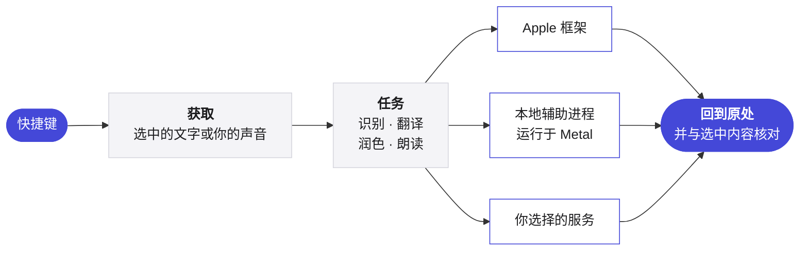

<p align="center">
  <picture>
    <source media="(prefers-color-scheme: dark)" srcset="../Assets/Yullo-dark.png">
    
  </picture>
</p>

<h1 align="center">Yullo</h1>

<p align="center">
  <b>你的想法，轻松表达。</b><br>
  在 Mac 上的任意应用中说、译、润色、聆听。
</p>

<p align="center">
  <a href="https://github.com/supnorm/Yullo/releases/latest"></a>
  
  
  
  <a href="../LICENSE"></a>
  
</p>

<p align="center">
  <a href="https://yullo.me"><b>yullo.me</b></a>
  &nbsp;·&nbsp;
  <a href="https://github.com/supnorm/Yullo/releases/latest">下载</a>
  &nbsp;·&nbsp;
  <a href="#build">从源码构建</a>
</p>

<p align="center">
  <sub>
    <a href="../README.md">English</a> ·
    <b>简体中文</b> ·
    <a href="README.zh-Hant.md">繁體中文</a> ·
    <a href="README.fr.md">Français</a> ·
    <a href="README.de.md">Deutsch</a> ·
    <a href="README.it.md">Italiano</a> ·
    <a href="README.es.md">Español</a>
  </sub>
</p>

<br>

在任意应用中，Yullo 只需一个快捷键。选中一句话，译文或润色后的文字就回到原处。开口说话，你的话会出现在光标所在的地方：保留原话、换成另一种语言，或按你选择的风格写好。

它是一款原生 Mac 应用。识别、翻译和语音模型可以完全在你的 Mac 上运行，你也可以随时接入自己常用的服务。

<br>

## 亮点

- **四项任务，处处可用。** 在任意应用中听写、翻译、润色和朗读，通过系统自带的文本框完成，应用支持时还可撤销。
- **彻底原生。** 基于 Swift、SwiftUI 和 AppKit，面向 macOS 26，使用 Liquid Glass 和系统自带控件。
- **在 Apple 芯片上本地推理。** whisper.cpp、transcribe.cpp、llama.cpp 和 audio.cpp 固定版本并从源码构建，在 Metal 上运行，着色器在构建时编译，模型不到一秒即可就绪。
- **边说边出字。** 流式识别在指示器中显示临时文字，只有最终文字才会被插入、翻译或润色。
- **引擎由你选择。** Apple 框架、可下载的本地模型、Ollama、任何兼容 OpenAI 的 API、Codex CLI 或 Claude Code，以及云端语音，按任务分别选择。
- **语音或文字编辑。** 选中文字，再说出或输入要改什么。先看改好的文字，再点“替换”换掉原文。
- **随你而变。** 用格式把随口一说变成邮件、笔记或你自己的样式，并按应用分别选择；还有收录你常用词的个人词汇表。
- **七种语言。** 整个界面支持英语、简体中文、繁体中文、法语、德语、意大利语和西班牙语。

<br>

## 引擎

| 任务 | 在你的 Mac 上 | 或接入 |
|:--|:--|:--|
| **听写** | Apple 语音识别，或 Qwen3 ASR、Parakeet、Whisper、SenseVoice、Cohere Transcribe、Nemotron | — |
| **翻译** | Apple 翻译，或 Hy-MT2、TranslateGemma、Qwen3，或 Ollama | 任何兼容 OpenAI 的 API，或你已在用的 Codex CLI 和 Claude Code |
| **写作** | Apple 设备端模型，或 Ollama | 任何兼容 OpenAI 的 API，或你已在用的 Codex CLI 和 Claude Code |
| **朗读** | macOS 声音，或 Kokoro、Qwen3 TTS、CosyVoice 3 | Azure Speech、Google Cloud Text-to-Speech、ElevenLabs 或自定义语音 API |

模型不包含在本仓库中。Yullo 在应用内直接从发布者处下载模型，校验每个文件，并为你的 Mac 推荐合适的模型。

<br>

## 隐私为本

- 语音识别在你的 Mac 上运行。开启<b>仅限这台 Mac</b>后，所有任务都在本机完成。
- 每个请求只包含当前任务的文字或音频，不附带其他内容。
- API 密钥保存在 macOS 钥匙串中，从不写入设置或文件。
- 检查更新只发送应用的版本号，并可在设置中关闭。
- 没有数据分析，也无需账户。

<br>

## 工作原理



本地引擎作为签名的独立辅助进程运行在应用包内，工作期间保持加载，后续请求无需重新启动。与服务商无关的规则，例如提示词、长文本规划和历史保留，以仅依赖 Foundation 的 Swift 编写，与界面分开。

<br>

## 安装

适用于搭载 Apple 芯片、运行 macOS 26 或更高版本的 Mac。如果你在用编程助手，可以让它替你安装 Yullo：

> 用 https://yullo.me/install.sh 在这台 Mac 上安装 Yullo。

或者在终端中运行：

```sh
curl -fsSL https://yullo.me/install.sh | sh
```

脚本会下载最新版本，用公布的 SHA-256 校验，然后把 Yullo 放进“应用程序”。如有需要，可以先[阅读脚本](https://github.com/supnorm/yullo.me/blob/main/install.sh)。

更喜欢磁盘映像？从[最新版本](https://github.com/supnorm/Yullo/releases/latest)下载 `Yullo.dmg`，把 Yullo 拖进“应用程序”。首次打开时，macOS 会请你确认：系统设置 › 隐私与安全性 › 仍要打开。

然后打开 Yullo，欢迎向导会带你设置语言、授予权限并完成第一次听写。

<br>

<a id="build"></a>

## 从源码构建

需要 Xcode 26（用 `xcode-select` 选中）、`git`、`cmake` 和 `python3`。

```sh
git clone https://github.com/supnorm/Yullo.git
cd Yullo

# 仅首次：创建本地代码签名身份
# （或使用你自己的证书：--identity <40 位 SHA-1>）
python3 scripts/setup-signing.py --create

# 构建、签名并检查 build/Yullo.app
bash build.sh

# 安装
python3 scripts/install-update.py --destination /Applications/Yullo.app
```

首次构建会获取并校验内置运行时的固定版本源码，因此需要联网，耗时也较长。请把文件夹放在较短的路径中，例如 `~/Yullo`，因为语音运行时对路径长度有限制。构建从不下载模型。

<details>
<summary><b>仓库结构</b></summary>

<br>

```
App/            Mac 应用，每个领域一个文件夹：Voice、Translation、ReadAloud、Selection、Settings…
Core/           与服务商无关的规则，以仅依赖 Foundation 的 Swift 编写
Runtime/        本地识别、翻译和语音运行时的轻量封装
Localizations/  七种语言的界面文字
Assets/         图标、字体和示例声音
scripts/        构建、签名、打包和安装
```

</details>

<br>

## 反馈

欢迎在 [Issues](https://github.com/supnorm/Yullo/issues) 或通过 [hi@yullo.me](mailto:hi@yullo.me) 提出问题、想法或报告错误。

<br>

## 致谢

Yullo 建立在 [whisper.cpp](https://github.com/ggml-org/whisper.cpp)、[llama.cpp](https://github.com/ggml-org/llama.cpp)、[ggml](https://github.com/ggml-org/ggml)、[transcribe.cpp](https://github.com/handy-computer/transcribe.cpp)、audio.cpp、[eSpeak NG](https://github.com/espeak-ng/espeak-ng) 和 [IBM Plex Mono](https://github.com/IBM/plex) 的成果之上，也感谢发布这些模型的人。

<br>

---

<p align="center">
  <sub>
    基于 <a href="../LICENSE">Apache License 2.0</a> 免费开源，详见 <a href="../NOTICE">NOTICE</a>。<br>
    Yullo™ 和 Yullo 标志是商标，不在许可范围内。<br>
    内置组件保留各自的许可，列在应用的 关于 › 开源许可 中。<br>
    本地语音辅助程序包含 eSpeak NG，采用 GPL-3.0-or-later，每个版本旁都附有其完整源码。<br>
    可下载的模型由其发布者按各自的条款提供。
  </sub>
</p>
