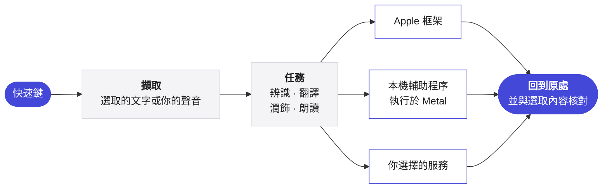

<p align="center">
  <picture>
    <source media="(prefers-color-scheme: dark)" srcset="../Assets/Yullo-dark.png">
    
  </picture>
</p>

<h1 align="center">Yullo</h1>

<p align="center">
  <b>你的想法，輕鬆表達。</b><br>
  在 Mac 上的任何應用程式中說、譯、潤飾、聆聽。
</p>

<p align="center">
  <a href="https://github.com/supnorm/Yullo/releases/latest"></a>
  
  
  
  <a href="../LICENSE"></a>
  
</p>

<p align="center">
  <a href="https://yullo.me"><b>yullo.me</b></a>
  &nbsp;·&nbsp;
  <a href="https://github.com/supnorm/Yullo/releases/latest">下載</a>
  &nbsp;·&nbsp;
  <a href="#build">從原始碼建置</a>
</p>

<p align="center">
  <sub>
    <a href="../README.md">English</a> ·
    <a href="README.zh-Hans.md">简体中文</a> ·
    <b>繁體中文</b> ·
    <a href="README.fr.md">Français</a> ·
    <a href="README.de.md">Deutsch</a> ·
    <a href="README.it.md">Italiano</a> ·
    <a href="README.es.md">Español</a>
  </sub>
</p>

<br>

在任何應用程式中，Yullo 只需一個快速鍵。選取一句話，譯文或潤飾後的文字就回到原處。開口說話，你的話會出現在游標所在的地方：保留原話、換成另一種語言，或依你選擇的風格寫好。

它是一款原生 Mac 應用程式。辨識、翻譯和語音模型可以完全在你的 Mac 上執行，你也可以隨時接上自己常用的服務。

<br>

## 特色

- **四項任務，處處可用。** 在任何應用程式中聽寫、翻譯、潤飾和朗讀，透過系統內建的文字欄位完成，應用程式支援時還能還原。
- **徹底原生。** 以 Swift、SwiftUI 和 AppKit 打造，適用 macOS 26，使用 Liquid Glass 和系統內建控制項。
- **在 Apple 晶片上本機推論。** whisper.cpp、transcribe.cpp、llama.cpp 和 audio.cpp 固定版本並從原始碼建置，在 Metal 上執行，著色器在建置時編譯，模型不到一秒即可就緒。
- **邊說邊出字。** 串流辨識在指示器中顯示暫時文字，只有最終文字才會被插入、翻譯或潤飾。
- **引擎由你選擇。** Apple 框架、可下載的本機模型、Ollama、任何相容 OpenAI 的 API、Codex CLI 或 Claude Code，以及雲端語音，依任務分別選擇。
- **用語音或文字編輯。** 選取文字，再說出或輸入要改什麼。先看改好的文字，再按「取代」換掉原文。
- **隨你而變。** 用格式把隨口一說變成郵件、筆記或你自己的樣式，並依應用程式分別選擇；還有收錄你常用詞的個人詞彙表。
- **七種語言。** 整個介面支援英文、簡體中文、繁體中文、法文、德文、義大利文和西班牙文。

<br>

## 引擎

| 任務 | 在你的 Mac 上 | 或連接 |
|:--|:--|:--|
| **聽寫** | Apple 語音辨識，或 Qwen3 ASR、Parakeet、Whisper、SenseVoice、Cohere Transcribe、Nemotron | — |
| **翻譯** | Apple 翻譯，或 Hy-MT2、TranslateGemma、Qwen3，或 Ollama | 任何相容 OpenAI 的 API，或你已在用的 Codex CLI 和 Claude Code |
| **寫作** | Apple 裝置端模型，或 Ollama | 任何相容 OpenAI 的 API，或你已在用的 Codex CLI 和 Claude Code |
| **朗讀** | macOS 聲音，或 Kokoro、Qwen3 TTS、CosyVoice 3 | Azure Speech、Google Cloud Text-to-Speech、ElevenLabs 或自訂語音 API |

模型不包含在本儲存庫中。Yullo 在應用程式內直接從發布者下載模型，驗證每個檔案，並為你的 Mac 推薦合適的模型。

<br>

## 以隱私為本

- 語音辨識在你的 Mac 上執行。開啟<b>僅限這台 Mac</b>後，所有任務都在本機完成。
- 每個請求只包含目前任務的文字或音訊，不附帶其他內容。
- API 金鑰保存在 macOS 鑰匙圈中，從不寫入設定或檔案。
- 檢查更新只傳送 App 的版本，並可在設定中關閉。
- 沒有數據分析，也不需要帳號。

<br>

## 運作方式



本機引擎以已簽署的獨立輔助程序在應用程式套件內執行，工作期間保持載入，之後的請求不必重新啟動。與服務供應商無關的規則，例如提示詞、長文規劃和歷史保留，以只依賴 Foundation 的 Swift 撰寫，與介面分開。

<br>

## 安裝

適用於搭載 Apple 晶片、執行 macOS 26 或以上版本的 Mac。如果你在用程式設計助理，可以讓它替你安裝 Yullo：

> 用 https://yullo.me/install.sh 在這台 Mac 上安裝 Yullo。

或在「終端機」中執行：

```sh
curl -fsSL https://yullo.me/install.sh | sh
```

腳本會下載最新版本，以公布的 SHA-256 驗證，再把 Yullo 放進「應用程式」。若有需要，可以先[閱讀腳本](https://github.com/supnorm/yullo.me/blob/main/install.sh)。

比較喜歡磁碟映像檔？從[最新版本](https://github.com/supnorm/Yullo/releases/latest)下載 `Yullo.dmg`，把 Yullo 拖進「應用程式」。第一次打開時，macOS 會請你確認：系統設定 › 隱私權與安全性 › 強制打開。

接著打開 Yullo，歡迎導覽會帶你設定語言、授予權限並完成第一次聽寫。

<br>

<a id="build"></a>

## 從原始碼建置

需要 Xcode 26（以 `xcode-select` 選取）、`git`、`cmake` 和 `python3`。

```sh
git clone https://github.com/supnorm/Yullo.git
cd Yullo

# 僅第一次：建立本機程式碼簽署身分
# （或使用你自己的憑證：--identity <40 位 SHA-1>）
python3 scripts/setup-signing.py --create

# 建置、簽署並檢查 build/Yullo.app
bash build.sh

# 安裝
python3 scripts/install-update.py --destination /Applications/Yullo.app
```

第一次建置會取得並驗證內建執行環境的固定版本原始碼，因此需要網路，也比較耗時。請把資料夾放在較短的路徑中，例如 `~/Yullo`，因為語音執行環境對路徑長度有限制。建置從不下載模型。

<details>
<summary><b>儲存庫結構</b></summary>

<br>

```
App/            Mac 應用程式，每個領域一個資料夾：Voice、Translation、ReadAloud、Selection、Settings…
Core/           與服務供應商無關的規則，以只依賴 Foundation 的 Swift 撰寫
Runtime/        本機辨識、翻譯和語音執行環境的輕量封裝
Localizations/  七種語言的介面文字
Assets/         圖像、字體和示範聲音
scripts/        建置、簽署、封裝和安裝
```

</details>

<br>

## 意見回饋

歡迎在 [Issues](https://github.com/supnorm/Yullo/issues) 或透過 [hi@yullo.me](mailto:hi@yullo.me) 提出問題、想法或回報錯誤。

<br>

## 致謝

Yullo 建立在 [whisper.cpp](https://github.com/ggml-org/whisper.cpp)、[llama.cpp](https://github.com/ggml-org/llama.cpp)、[ggml](https://github.com/ggml-org/ggml)、[transcribe.cpp](https://github.com/handy-computer/transcribe.cpp)、audio.cpp、[eSpeak NG](https://github.com/espeak-ng/espeak-ng) 和 [IBM Plex Mono](https://github.com/IBM/plex) 的成果之上，也感謝發布這些模型的人。

<br>

---

<p align="center">
  <sub>
    依 <a href="../LICENSE">Apache License 2.0</a> 免費開源，詳見 <a href="../NOTICE">NOTICE</a>。<br>
    Yullo™ 和 Yullo 標誌是商標，不在授權範圍內。<br>
    內建元件保留各自的授權，列在應用程式的 關於 › 開放原始碼授權 中。<br>
    本機語音輔助程式包含 eSpeak NG，採用 GPL-3.0-or-later，每個版本旁都附有完整原始碼。<br>
    可下載的模型由其發布者依各自條款提供。
  </sub>
</p>
